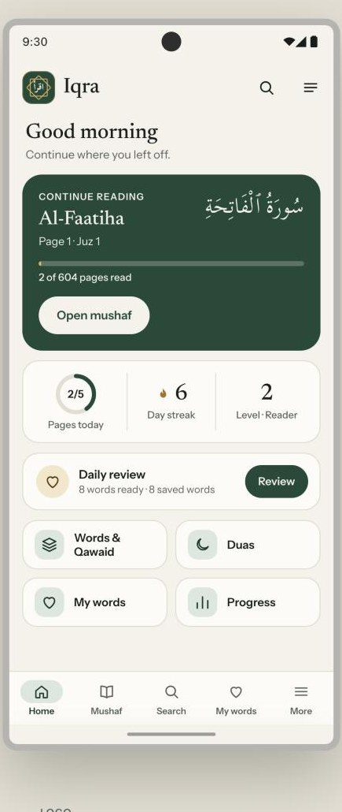
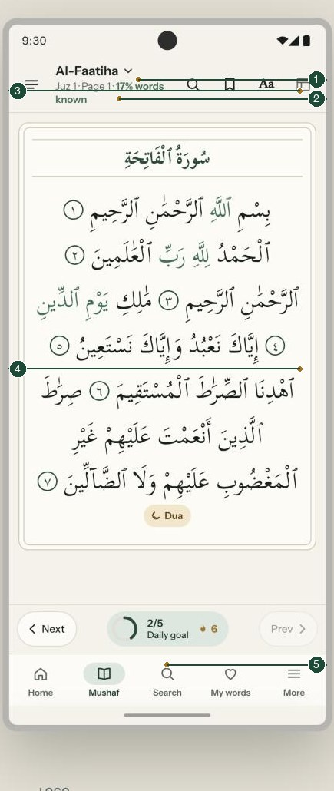
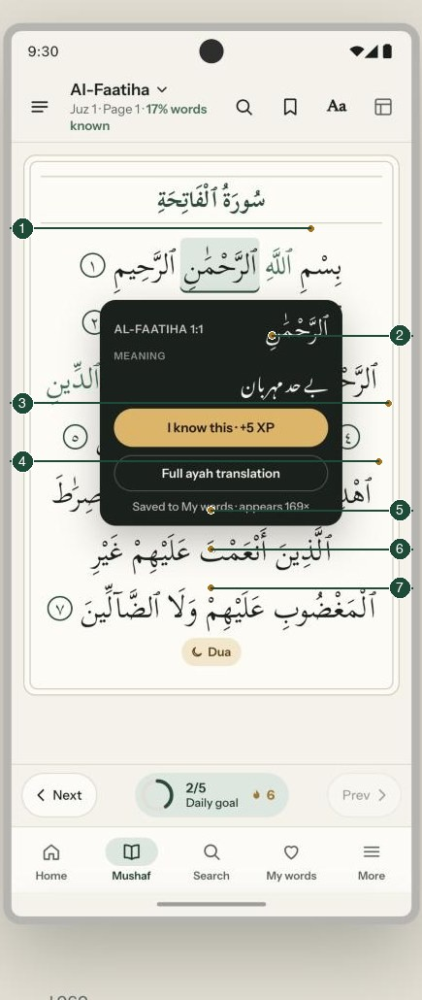
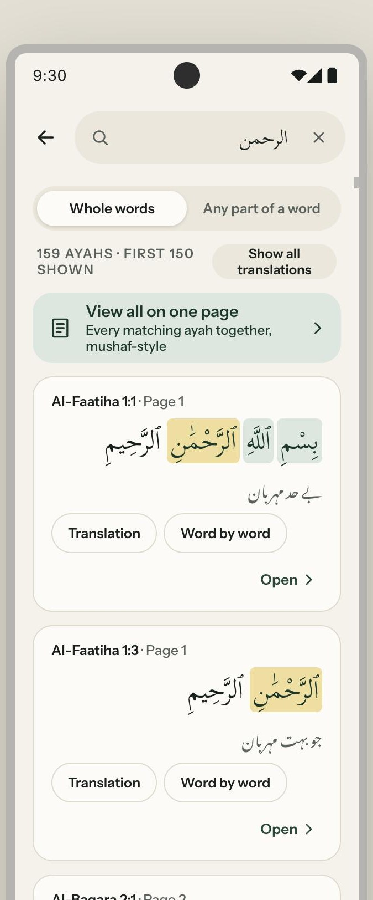
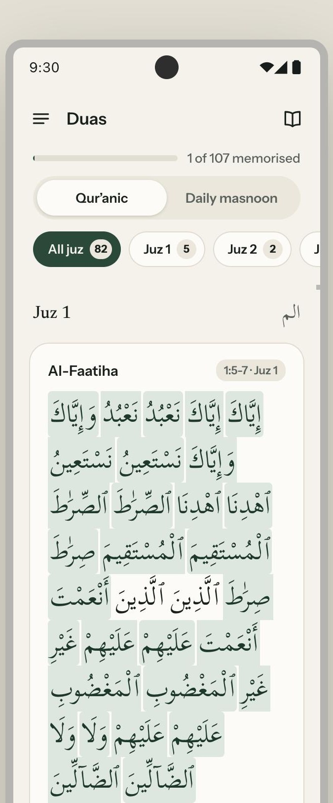
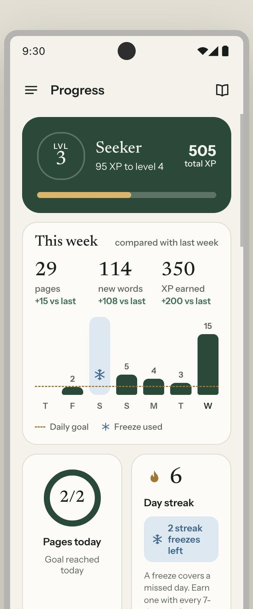

<div align="center">

# Iqra

### Learn the Quran word by word — Arabic text, Urdu meanings, built-in progress tracking. Offline PWA + Android.


&nbsp;

&nbsp;

&nbsp;


<br /><br />

**Open the app → tap any word → see its Urdu meaning → build vocabulary you keep.**  
All 604 Quran pages. Urdu word-by-word meanings. Search. Duas. Qawaid. No internet needed after install.

<br />

[Open Web App](https://iqra-quran-learning-eight.vercel.app)
&nbsp;&nbsp;·&nbsp;&nbsp;
[Download APK](https://github.com/baheesa/iqra-quran-learning/releases/latest)
&nbsp;&nbsp;·&nbsp;&nbsp;
[📘 PDF Manual](docs/manual/user-manual.pdf)

<br />



<sub>Offline PWA · Android APK · No account needed</sub>

</div>

---

## Who is this for?

Most people who grew up reciting the Quran can read Arabic without stumbling — and understand almost none of it. They know the sounds, not the words.

Tafseer apps give you full commentary. Translation apps show sentence-level Urdu. Neither tells you what the individual word in front of you means — so vocabulary never sticks.

Iqra is built for that gap. Tap any Arabic word on any of the 604 pages, and a panel shows its Urdu meaning right there in context. Once you know الرَّحْمَٰنِ, you've unlocked a word that shows up 169 times across the Quran. That compounds.

| Who | What they get |
| --- | --- |
| People who recite daily but don't understand | Tap words during regular tilawat — no separate study session needed |
| Students learning Quranic Arabic | Word meanings + Qawaid rules together, anchored to real ayaat |
| Parents teaching children | No ads, no account, no setup — hand it over and it works |
| Anyone starting Quran from scratch | Daily goal + streak counter to keep the habit going |

---

## What's in the app?

| Feature | Detail |
| --- | --- |
| Quran pages | All 604 pages with Scheherazade Arabic font |
| Word meanings | Tap any word → Urdu meaning + transliteration |
| Search | Search by surah name, ayah number, or keyword |
| Duas | Daily duas with Arabic and Urdu |
| Qawaid | Basic Tajweed rules with examples |
| Progress | Track pages read, daily goal, streaks |
| Offline | Works fully without internet after first load |

<p align="center">
  
  &nbsp;
  
  &nbsp;
  
</p>

<p align="center">
  <sub>Left: Mushaf view · Center: Word meaning popup · Right: Search</sub>
</p>

---

## Screenshots

<table>
<tr>
<td width="50%" valign="top" align="center">

### Home
Continue reading where you left off. Your streak, daily pages, and level at a glance.


</td>
<td width="50%" valign="top" align="center">

### Mushaf
Full-page Arabic text. Swipe to turn pages. Tap any word for its meaning.


</td>
</tr>
<tr>
<td width="50%" valign="top" align="center">

### Word meanings
Tap a word — its Urdu meaning, transliteration, and how many times it appears in the Quran.


</td>
<td width="50%" valign="top" align="center">

### Search
Search by Arabic word, Urdu meaning, or surah name. Results open directly on the mushaf.


</td>
</tr>
<tr>
<td width="50%" valign="top" align="center">

### Duas
Quranic duas and daily masnoon duas, browseable by Juz.



</td>
<td width="50%" valign="top" align="center">

### Progress
Weekly pages, new words, XP earned — with a bar chart and streak counter.



</td>
</tr>
</table>

---

## User manual

Full walkthrough — every screen, every feature:

**[📘 Download PDF Manual](docs/manual/user-manual.pdf)**

---

## Try it now

**Web (no install):**

Open [iqra-quran-learning-eight.vercel.app](https://iqra-quran-learning-eight.vercel.app) in any browser. Works on phone and desktop. Add to home screen for offline access.

**Android APK:**

Download from [Releases](https://github.com/baheesa/iqra-quran-learning/releases/latest). Install the APK directly — no Play Store needed. Enable "Install from unknown sources" in Android settings if prompted.

---

## Run locally

No build step required:

```bash
cd assets
python3 -m http.server 5173
```

Open [http://localhost:5173](http://localhost:5173).

Or open `assets/index.html` directly in a browser.

---

## Project layout

```text
assets/               Static PWA (HTML · CSS · JS · data)
assets/index.html     Single-file app entry point
assets/data/          Quran data: surahs, wbw-urdu, duas, qawaid
docs/images/          README screenshots
docs/manual/          PDF user manual
```

---

## Stack

| Layer | Tech |
| --- | --- |
| UI | React 18 (UMD, no build step) |
| Fonts | Scheherazade New · Noto Nastaliq Urdu · Instrument Sans |
| Data | Static JSON — all Quran data bundled |
| Hosting | Vercel (web) · Direct APK (Android) |
| Offline | PWA manifest + service worker |
